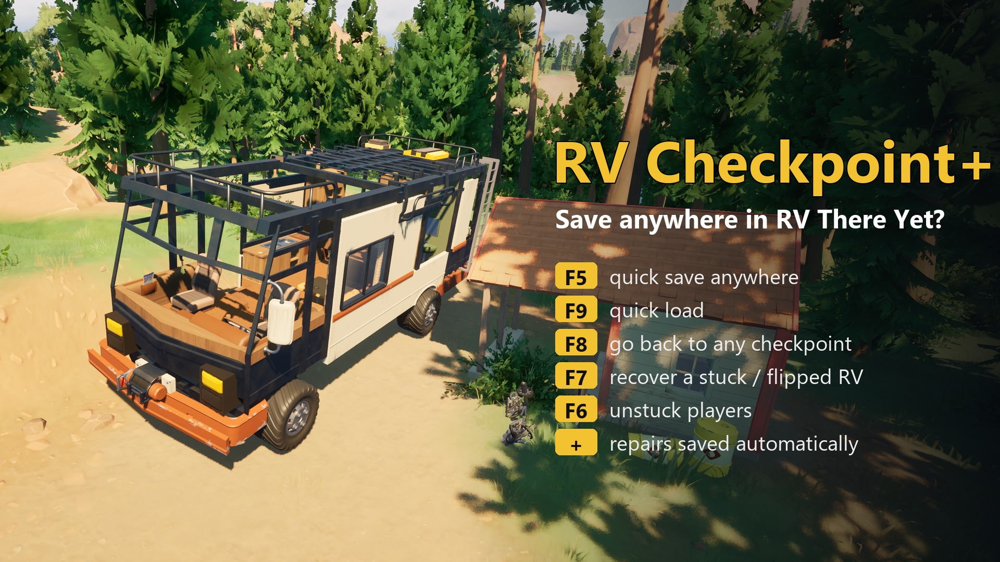

# RV Checkpoint+ (RV There Yet?)

**English** | [Русский](README.ru.md) | [Polski](README.pl.md)

The most common complaint in recent negative Steam reviews: you can only save at fixed checkpoints. One bad jump,
one glitch or one bear sends the whole group back, and a reload throws away the repairs you made since then.

RV Checkpoint+ adds:

| Key | What it does |
|---|---|
| **F5** | **Quick save.** Saves the RV right now: damage, repairs, items on it, inventory, and where it stands. |
| **F9** | **Quick load.** Takes you back to your last quick save. It does not send you back to the checkpoint. |
| **Shift+F9** | **Backups.** The mod keeps the last 3 copies of the game's own save (one at every quick save and checkpoint). Shift+F9 lists them (press again for older ones), F9 restores the selected one. A broken save no longer ruins the run. |
| **F8** | **Checkpoint menu.** Go back to any earlier checkpoint, for example to fetch an item you missed. Press F8 again to step back further, F9 to go, or wait to cancel. The RV keeps its current repairs. |
| **F7** | **Recover RV.** Flipped, stuck, or fell through the world? The first press lifts it free. A second press within a few seconds puts it back on its wheels at the last safe spot. |
| **F6** | **Unstuck.** Puts you next to the RV door. **Shift+F6** brings every player to the RV. |
| (auto) | **Repairs are saved** a few seconds after the RV gets repaired, so a reload no longer undoes them. |

More details:
- **Game over keeps your quick save.** When the RV is destroyed, the game restarts and the mod puts the RV and
  players back at your quick save, not at the checkpoint.
- **Quit mid-route.** Press F5, quit, then use *Load Game* later and you continue from the quick save.
- **Old quick saves expire.** Reaching a new checkpoint replaces the old quick save. Starting a new game that
  reuses an old name ignores the old file.
- **No bad saves.** The mod won't quick save while the RV is in the air or on its side.
- **Safe loading.** The RV is set straight down on its wheels, players come back around the RV (on the ground, never in
  mid-air) and nobody can take damage while a quick save loads. If the game ends (game over) within a minute of
  loading a quick save, the next restart stays at the checkpoint instead of looping; F9 still loads the quick save.

## Install
The mod runs on **UE4SS**. Without it nothing happens at all, and Vortex does not install UE4SS for you.

**Easiest:** download `RVCheckpointPlus-<version>-with-UE4SS.zip` and extract it into the game folder
(`...\steamapps\common\RV There Yet?`, the folder that has `Ride.exe`). It already contains UE4SS and the mod in
the right places. Start the game; a message appears on screen when you press F5.

**Manual / you already have UE4SS:**
1. Copy `dwmapi.dll` and the `ue4ss` folder from a recent
   [RE-UE4SS experimental build](https://github.com/UE4SS-RE/RE-UE4SS/releases/tag/experimental-latest) next to
   `RV There Yet?\Ride\Binaries\Win64\Ride-Win64-Shipping.exe`. Old UE4SS builds may not start on game v1.4.
2. Copy the `RVCheckpointPlus` folder into `...\Win64\ue4ss\Mods\`. It already contains `enabled.txt`.
3. Start the game.

Settings live in `RVCheckpointPlus\Scripts\config.lua`: keys, auto-save after repair, a timed auto-save, and
on-screen message length.

## Multiplayer
- Only the **host** needs the mod. Saves and checkpoints belong to the host in this game. Players without the
  mod can join.
- The RV is moved with the game's own network teleport, so every player's copy of the RV moves the same way.
  (Version 1.0.0 switched the RV's physics off while loading; friends then saw its armor panels under the ground and
  the RV could blow up when they touched it. Fixed in 1.1.0.)
- Players are moved with the game's own `TeleportPlayerTo`.
- Tested in co-op as host + one friend (two game copies): quick save/load near and far from the checkpoint, F7, F6,
  Shift+F6, backups, game over. The friend may have the mod too: their F6 works, host-only keys just say so.

## Uninstall
Delete `ue4ss\Mods\RVCheckpointPlus`. Quick saves live in its `saves` folder. Your normal game saves are never
changed, except by the game's own save function.

## Compatibility
- Tested on game version **v1.4.1.22052** (UE 5.6) with UE4SS v3.0.1-1218, Mabutts Valley.
- It doesn't replace any game files and uses no pak mods. If it stops working after a game update, update UE4SS first.

## Changes
- **1.1.0**: co-op fix (RV armor under the ground / RV exploding for friends after a load), RV lands on its wheels
  instead of dropping from 3 m, players are restored around the RV and protected while loading (no more death loops),
  game-over loop guard, 3 rotating backups of the game save (Shift+F9), package with UE4SS included, tested on v1.4.1.
- **1.0.0**: first release.

## Credits
- Mod created by Claude (Anthropic AI) for [immortalsouul](https://www.nexusmods.com/profile/immortalsouul), who playtested it in game and publishes it.
- UE4SS by the UE4SS-RE team.
- RV There Yet? by Nuggets Entertainment.

## License
MIT (see `LICENSE`). This repository contains no game files.
