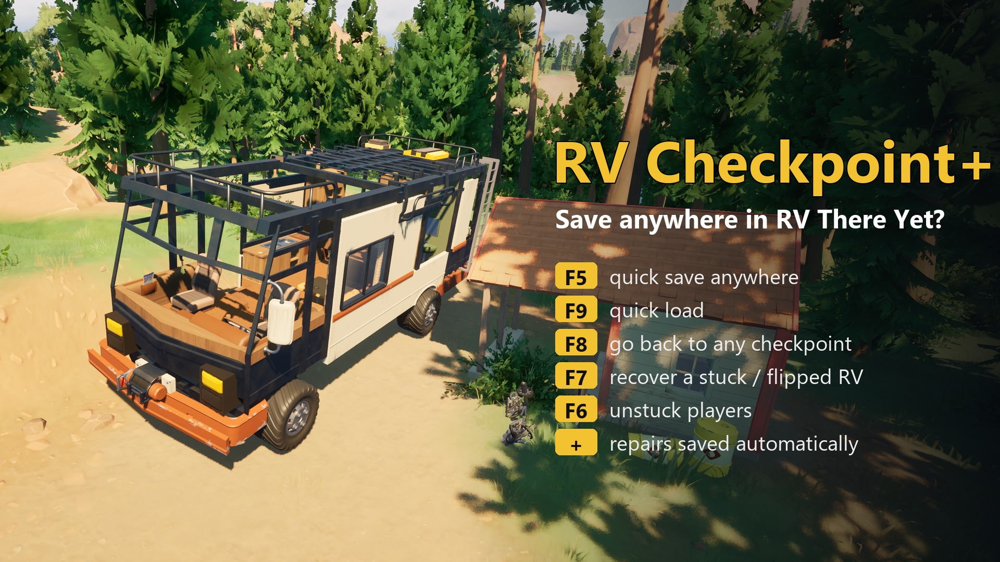

# RV Checkpoint+ (RV There Yet?)

[English](README.md) | [Русский](README.ru.md) | **Polski**

Najczęstsza skarga w świeżych negatywnych recenzjach na Steam: zapisywać można tylko na stałych punktach kontrolnych.
Jeden zły skok, jeden błąd albo jeden niedźwiedź cofa całą grupę, a wczytanie wyrzuca naprawy zrobione od tamtej
pory.

RV Checkpoint+ dodaje:

| Klawisz | Co robi |
|---|---|
| **F5** | **Szybki zapis.** Zapisuje kampera teraz: uszkodzenia, naprawy, przedmioty na nim, ekwipunek i to, gdzie stoi. |
| **F9** | **Szybkie wczytanie.** Wraca do ostatniego szybkiego zapisu. Nie cofa do punktu kontrolnego. |
| **Shift+F9** | **Kopie zapasowe.** Mod trzyma 3 ostatnie kopie zwykłego zapisu gry (przy każdym szybkim zapisie i punkcie kontrolnym). Shift+F9 je pokazuje (jeszcze raz = starsza), F9 przywraca wybraną. Uszkodzony zapis nie psuje już całej gry. |
| **F8** | **Menu punktów kontrolnych.** Wróć do dowolnego wcześniejszego punktu, np. po pominięty przedmiot. Naciśnij F8 ponownie, by cofnąć się dalej, F9, by jechać, albo poczekaj, by anulować. Kamper zachowuje obecne naprawy. |
| **F7** | **Ratuj kampera.** Przewrócony, zakleszczony albo wpadł pod świat? Pierwsze naciśnięcie go uwalnia. Drugie w ciągu kilku sekund stawia go z powrotem na koła w ostatnim bezpiecznym miejscu. |
| **F6** | **Odblokuj.** Stawia Cię przy drzwiach kampera. **Shift+F6** sprowadza do kampera wszystkich graczy. |
| (auto) | **Naprawy są zapisywane** kilka sekund po naprawie kampera, więc wczytanie już ich nie cofa. |

Więcej szczegółów:
- **Koniec gry zachowuje szybki zapis.** Gdy kamper zostanie zniszczony, gra startuje od nowa, a mod ustawia kampera
  i graczy w miejscu szybkiego zapisu, nie na punkcie kontrolnym.
- **Wyjście w połowie trasy.** Naciśnij F5, wyjdź, a później użyj *Wczytaj grę* i kontynuujesz od szybkiego zapisu.
- **Stare szybkie zapisy wygasają.** Dotarcie do nowego punktu kontrolnego zastępuje stary szybki zapis. Nowa gra
  o starej nazwie ignoruje stary plik.
- **Żadnych złych zapisów.** Mod nie zapisze, gdy kamper jest w powietrzu albo na boku.
- **Bezpieczne wczytywanie.** Kamper staje prosto na kołach, gracze wracają wokół niego (na ziemi, nigdy w powietrzu),
  a podczas wczytywania nikt nie otrzymuje obrażeń. Jeśli gra skończy się (game over) w ciągu minuty od wczytania,
  następny restart zostaje na punkcie kontrolnym zamiast wpadać w pętlę; F9 i tak wczyta szybki zapis.

## Instalacja
Mod działa na **UE4SS**. Bez niego nic się nie dzieje, a Vortex nie instaluje UE4SS za ciebie.

**Najprościej:** pobierz `RVCheckpointPlus-<wersja>-with-UE4SS.zip` i rozpakuj do folderu gry
(`...\steamapps\common\RV There Yet?`, tam gdzie jest `Ride.exe`). W środku jest już UE4SS i mod na właściwych
miejscach. Uruchom grę; po naciśnięciu F5 na ekranie pojawi się komunikat.

**Ręcznie / masz już UE4SS:**
1. Skopiuj `dwmapi.dll` i folder `ue4ss` z aktualnej
   [eksperymentalnej wersji RE-UE4SS](https://github.com/UE4SS-RE/RE-UE4SS/releases/tag/experimental-latest) obok
   `RV There Yet?\Ride\Binaries\Win64\Ride-Win64-Shipping.exe`. Stare wersje UE4SS mogą nie działać na v1.4.
2. Skopiuj folder `RVCheckpointPlus` do `...\Win64\ue4ss\Mods\`. Zawiera już `enabled.txt`.
3. Uruchom grę.

Ustawienia są w `RVCheckpointPlus\Scripts\config.lua`: klawisze, automatyczny zapis po naprawie, zapis co określony
czas i długość komunikatów na ekranie.

## Gra wieloosobowa
- Mod potrzebny jest tylko **hostowi**. W tej grze zapisy i punkty kontrolne należą do hosta. Gracze bez moda mogą
  dołączyć.
- Kamper jest przenoszony własnym sieciowym teleportem gry, więc u każdego gracza jego kopia porusza się tak samo.
  (Wersja 1.0.0 wyłączała fizykę kampera przy wczytywaniu; znajomi widzieli wtedy jego pancerz pod ziemią, a kamper
  potrafił wybuchnąć przy dotknięciu. Naprawione w 1.1.0.)
- Gracze są przenoszeni własną funkcją gry `TeleportPlayerTo`.
- Sprawdzone w kooperacji: host + jeden znajomy (dwie kopie gry): szybki zapis/wczytanie blisko i daleko od punktu
  kontrolnego, F7, F6, Shift+F6, kopie zapasowe, game over. Znajomy też może mieć mod: jego F6 działa, a klawisze
  hosta tylko informują, że są dla hosta.

## Odinstalowanie
Usuń `ue4ss\Mods\RVCheckpointPlus`. Szybkie zapisy są w jego folderze `saves`. Twoje zwykłe zapisy gry nigdy nie są
zmieniane, poza własną funkcją zapisu gry.

## Zgodność
- Sprawdzone na wersji gry **v1.4.1.22052** (UE 5.6) z UE4SS v3.0.1-1218, Mabutts Valley.
- Nie podmienia żadnych plików gry i nie używa modów pak. Jeśli po aktualizacji gry przestanie działać, najpierw
  zaktualizuj UE4SS.

## Zmiany
- **1.1.0**: naprawiona kooperacja (pancerz pod ziemią / kamper wybucha u znajomych po wczytaniu), kamper staje na
  kołach zamiast spadać z 3 m, gracze wracają wokół kampera i są chronieni podczas wczytywania (koniec pętli śmierci),
  ochrona przed pętlą game over, 3 rotacyjne kopie zapisu gry (Shift+F9), paczka z UE4SS, sprawdzone na v1.4.1.
- **1.0.0**: pierwsze wydanie.

## Podziękowania
- Mod stworzony przez Claude (AI od Anthropic) dla [immortalsouul](https://www.nexusmods.com/profile/immortalsouul),
  który testował go w grze i go publikuje.
- UE4SS — zespół UE4SS-RE.
- RV There Yet? — Nuggets Entertainment.

Tłumaczenie przygotowane przy pomocy AI.

## Licencja
MIT (zob. `LICENSE`). To repozytorium nie zawiera plików gry.
