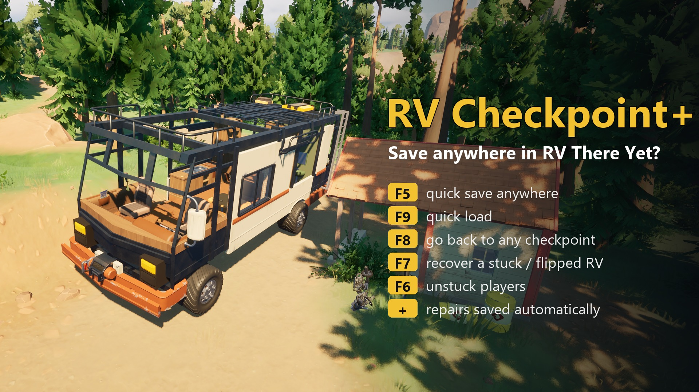

# RV Checkpoint+ (RV There Yet?)

[English](README.md) | **Русский** | [Polski](README.pl.md)

Самая частая жалоба в свежих негативных отзывах в Steam: сохраняться можно только на фиксированных чекпоинтах.
Один неудачный прыжок, один баг или один медведь отправляют всю компанию назад, а после загрузки пропадает весь
ремонт, сделанный с тех пор.

RV Checkpoint+ добавляет:

| Клавиша | Что делает |
|---|---|
| **F5** | **Быстрое сохранение.** Сохраняет RV прямо сейчас: повреждения, ремонт, предметы на нём, инвентарь и место, где он стоит. |
| **F9** | **Быстрая загрузка.** Возвращает к последнему быстрому сохранению, а не на чекпоинт. |
| **Shift+F9** | **Бэкапы.** Мод хранит 3 последние копии обычного сохранения игры (при каждом быстром сохранении и на чекпоинте). Shift+F9 показывает их (ещё раз — более старый), F9 восстанавливает выбранный. Испорченный сейв больше не губит прохождение. |
| **F8** | **Меню чекпоинтов.** Вернуться на любой пройденный чекпоинт, например за забытым предметом. F8 ещё раз — на чекпоинт раньше, F9 — перейти, подождать — отмена. Ремонт RV сохраняется. |
| **F7** | **Вытащить RV.** Перевернулся, застрял или провалился сквозь мир? Первое нажатие приподнимает его. Второе нажатие в течение нескольких секунд ставит его на колёса в последнем безопасном месте. |
| **F6** | **Выбраться.** Перемещает вас к двери RV. **Shift+F6** собирает у RV всех игроков. |
| (авто) | **Ремонт сохраняется** через пару секунд после починки RV, так что загрузка больше его не отменяет. |

Подробнее:
- **Game over не отнимает быстрое сохранение.** Если RV уничтожен, игра перезапускается, а мод возвращает RV и
  игроков к быстрому сохранению, а не на чекпоинт.
- **Можно выйти посреди пути.** Нажмите F5, выйдите, а потом через *Load Game* продолжите с быстрого сохранения.
- **Старые быстрые сохранения сбрасываются.** Когда вы доезжаете до нового чекпоинта, старое быстрое сохранение
  заменяется. Новая игра со старым названием не подхватит старый файл.
- **Никаких плохих сохранений.** Мод не сохраняет, пока RV в воздухе или лежит на боку.
- **Безопасная загрузка.** RV ставится прямо на колёса, игроки появляются вокруг RV (на земле, а не в воздухе), и
  пока грузится быстрое сохранение, никто не получает урон. Если игра закончилась (game over) в течение минуты после
  загрузки, следующий рестарт остаётся на чекпоинте, чтобы не было бесконечной петли; F9 всё равно загрузит сейв.

## Установка
Мод работает через **UE4SS**. Без него не происходит вообще ничего, а Vortex сам UE4SS не ставит.

**Проще всего:** скачайте `RVCheckpointPlus-<версия>-with-UE4SS.zip` и распакуйте в папку игры
(`...\steamapps\common\RV There Yet?`, где лежит `Ride.exe`). Внутри уже есть UE4SS и мод на своих местах.
Запустите игру; при нажатии F5 на экране появится сообщение.

**Вручную / UE4SS уже стоит:**
1. Скопируйте `dwmapi.dll` и папку `ue4ss` из свежей
   [экспериментальной сборки RE-UE4SS](https://github.com/UE4SS-RE/RE-UE4SS/releases/tag/experimental-latest) рядом с
   `RV There Yet?\Ride\Binaries\Win64\Ride-Win64-Shipping.exe`. Старые сборки UE4SS могут не запуститься на v1.4.
2. Скопируйте папку `RVCheckpointPlus` в `...\Win64\ue4ss\Mods\`. В ней уже есть `enabled.txt`.
3. Запустите игру.

Настройки лежат в `RVCheckpointPlus\Scripts\config.lua`: клавиши, автосохранение после ремонта, автосохранение
по таймеру и длительность сообщений на экране.

## Мультиплеер
- Мод нужен только **хосту**. Сохранения и чекпоинты в этой игре принадлежат хосту. Игроки без мода могут
  подключаться.
- RV перемещается встроенным сетевым телепортом игры, поэтому у каждого игрока его копия RV двигается одинаково.
  (Версия 1.0.0 при загрузке выключала физику RV; у друзей после этого броня RV оказывалась под землёй, а при
  попытке взаимодействия RV взрывался. Исправлено в 1.1.0.)
- Игроки перемещаются встроенной функцией игры `TeleportPlayerTo`.
- Проверено в коопе: хост + один друг (две копии игры): быстрое сохранение/загрузка рядом с чекпоинтом и далеко от
  него, F7, F6, Shift+F6, бэкапы, game over. У друга мод тоже может стоять: его F6 работает, а клавиши хоста просто
  сообщают, что они только для хоста.

## Удаление
Удалите папку `ue4ss\Mods\RVCheckpointPlus`. Быстрые сохранения лежат в её папке `saves`. Обычные сохранения игры
мод не меняет: их записывает только сама игра своей функцией сохранения.

## Совместимость
- Проверено на версии игры **v1.4.1.22052** (UE 5.6) с UE4SS v3.0.1-1218, карта Mabutts Valley.
- Мод не заменяет файлы игры и не использует pak-моды. Если после обновления игры он перестал работать, сначала
  обновите UE4SS.

## Изменения
- **1.1.0**: исправлен кооп (броня RV под землёй / RV взрывается у друзей после загрузки), RV встаёт на колёса, а не
  падает с 3 м, игроки появляются вокруг RV и защищены во время загрузки (больше никаких смертельных петель),
  защита от петли game over, 3 бэкапа сохранения игры по кругу (Shift+F9), архив сразу с UE4SS, проверено на v1.4.1.
- **1.0.0**: первый релиз.

## Благодарности
- Мод создан Claude (ИИ от Anthropic) для [immortalsouul](https://www.nexusmods.com/profile/immortalsouul), который протестировал его в игре и публикует.
- UE4SS — команда UE4SS-RE.
- RV There Yet? — Nuggets Entertainment.

## Лицензия
MIT (см. `LICENSE`). В репозитории нет файлов игры.
