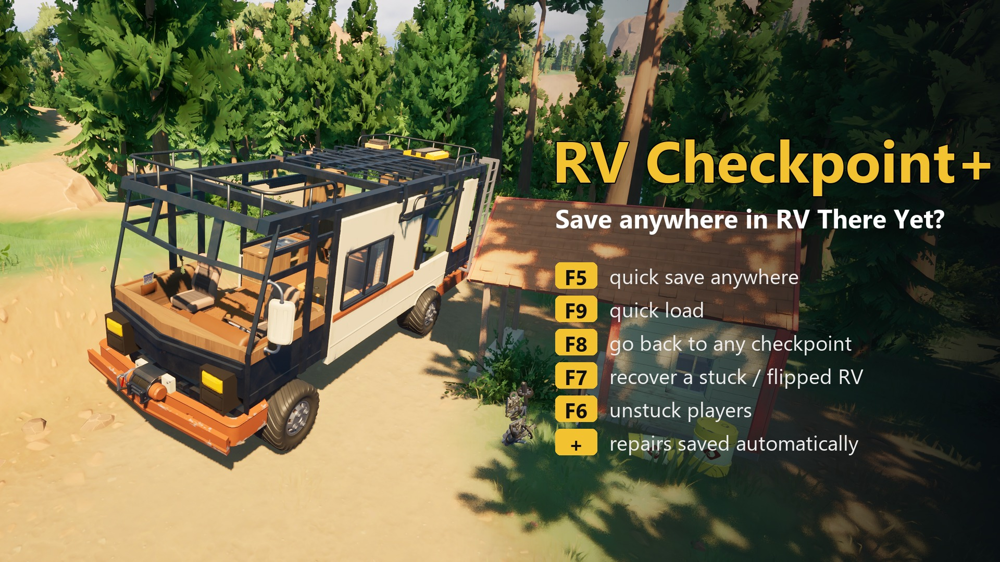

# RV Checkpoint+ (RV There Yet?)

[English](README.md) | **Русский**

Самая частая жалоба в свежих негативных отзывах в Steam: сохраняться можно только на фиксированных чекпоинтах.
Один неудачный прыжок, один баг или один медведь отправляют всю компанию назад, а после загрузки пропадает весь
ремонт, сделанный с тех пор.

RV Checkpoint+ добавляет:

| Клавиша | Что делает |
|---|---|
| **F5** | **Быстрое сохранение.** Сохраняет RV прямо сейчас: повреждения, ремонт, предметы на нём, инвентарь и место, где он стоит. |
| **F9** | **Быстрая загрузка.** Возвращает к последнему быстрому сохранению, а не на чекпоинт. |
| **F8** | **Меню чекпоинтов.** Вернуться на любой пройденный чекпоинт, например за забытым предметом. F8 ещё раз — на чекпоинт раньше, F9 — перейти, подождать — отмена. Ремонт RV сохраняется. |
| **F7** | **Вытащить RV.** Перевернулся, застрял или провалился сквозь мир? Первое нажатие приподнимает его. Второе нажатие в течение нескольких секунд ставит его на колёса в последнем безопасном месте. |
| **F6** | **Выбраться.** Перемещает вас к двери RV. **Shift+F6** собирает у RV всех игроков. |
| (авто) | **Ремонт сохраняется** через пару секунд после починки RV, так что загрузка больше его не отменяет. |

Подробнее:
- **Game over не отнимает быстрое сохранение.** Если RV уничтожен, игра перезапускается, а мод возвращает RV и
  игроков к быстрому сохранению, а не на чекпоинт.
- **Можно выйти посреди пути.** Нажмите F5, выйдите, а потом через *Load Game* продолжите с быстрого сохранения.
- **Старые быстрые сохранения сбрасываются.** Когда вы доезжаете до нового чекпоинта, старое быстрое сохранение
  заменяется. Новая игра со старым названием не подхватит старый файл.
- **Никаких плохих сохранений.** Мод не сохраняет, пока RV в воздухе или лежит на боку.

## Установка
1. Установите **UE4SS** (экспериментальная сборка, она поддерживает UE 5.6): скопируйте `dwmapi.dll` и папку
   `ue4ss` из [RE-UE4SS experimental-latest](https://github.com/UE4SS-RE/RE-UE4SS/releases/tag/experimental-latest)
   рядом с `RV There Yet?\Ride\Binaries\Win64\Ride-Win64-Shipping.exe`.
2. Скопируйте папку `RVCheckpointPlus` в `...\Win64\ue4ss\Mods\`. В ней уже есть `enabled.txt`.
3. Запустите игру.

Настройки лежат в `RVCheckpointPlus\Scripts\config.lua`: клавиши, автосохранение после ремонта, автосохранение
по таймеру и длительность сообщений на экране.

## Мультиплеер
- Мод нужен только **хосту**. Сохранения и чекпоинты в этой игре принадлежат хосту. Игроки без мода могут
  подключаться.
- Игроки перемещаются встроенной функцией игры `TeleportPlayerTo`.
- Пока мод проверен только при игре хостом в одиночку (на одном компьютере). Кооп с живыми друзьями не проверен,
  поэтому, пожалуйста, сообщайте, что происходит.

## Удаление
Удалите папку `ue4ss\Mods\RVCheckpointPlus`. Быстрые сохранения лежат в её папке `saves`. Обычные сохранения игры
мод не меняет: их записывает только сама игра своей функцией сохранения.

## Совместимость
- Проверено на версии игры **v1.3.20702** (UE 5.6), карты Mabutts Valley и Mt. Yurbuttsk.
- Мод не заменяет файлы игры и не использует pak-моды, поэтому обновления игры вряд ли его сломают.

## Благодарности
- Мод создан Claude (ИИ от Anthropic) для [immortalsouul](https://www.nexusmods.com/profile/immortalsouul), который протестировал его в игре и публикует.
- UE4SS — команда UE4SS-RE.
- RV There Yet? — Nuggets Entertainment.

## Лицензия
MIT (см. `LICENSE`). В репозитории нет файлов игры.
